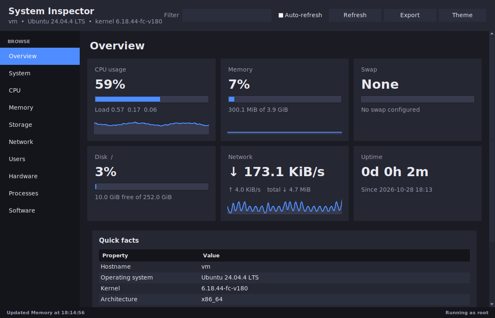
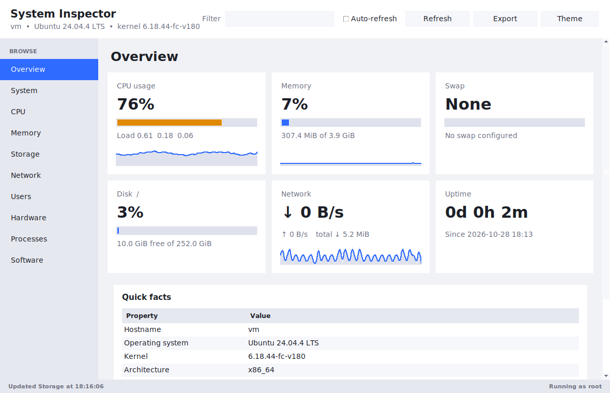
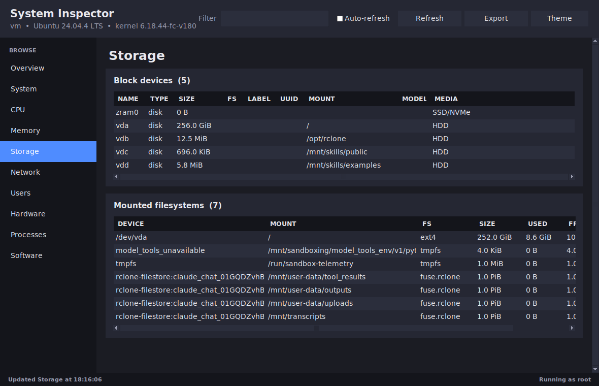

# System Inspector

A lightweight desktop app (and CLI) that shows **everything about your Linux system** in one place — hardware, storage and partitions, OS and kernel versions, users, network, processes, installed software and more.

No dependencies beyond Python 3 and Tkinter.

<p align="center">
  
  
</p>
<p align="center">
  
</p>

## Features

- **Live dashboard** – CPU, memory, swap, disk, network throughput and uptime, with real-time graphs
- **Ten pages** – Overview, System, CPU, Memory, Storage, Network, Users, Hardware, Processes, Software
- **Storage details** – every disk and partition (size, filesystem, label, UUID, mount point, SSD/HDD), usage per mount, and **SMART health** when `smartmontools` is installed and the app runs as root
- **Users** – all human accounts, admin status, groups, current and recent logins
- **Filter box** – instantly narrow every table (`ext4`, `ubuntu`, `eth0`, …)
- **Export** everything to JSON or plain text
- **Dark and light themes**, double-click any row to copy it
- **CLI mode** with `--json` output for scripts
- Works on any modern distro (Debian/Ubuntu, Fedora, Arch, openSUSE, …)

## Install

**1. Make sure Tkinter is available**

```bash
sudo apt install python3-tk          # Debian / Ubuntu / Mint
sudo dnf install python3-tkinter     # Fedora
sudo pacman -S tk                    # Arch
```

**2. Install System Inspector** (per-user, no root needed)

```bash
git clone https://github.com/Adityayadavup72/system-inspector.git
cd system-inspector
./install.sh
```

It will then appear in your application menu, or run `system-inspector` in a terminal.
Uninstall any time with `./uninstall.sh`.

**Or run without installing**

```bash
python3 -m system_inspector
```

**Or install with pip / pipx**

```bash
pipx install .            # recommended on modern distros
# pip install --user .
```

## Usage

```bash
system-inspector                       # GUI
sudo system-inspector                  # GUI with full hardware + SMART details

system-inspector-cli                   # print everything in the terminal
system-inspector-cli -s storage users  # only some sections
system-inspector-cli --json > out.json # machine-readable
system-inspector-cli --list            # list sections
```

Running as root unlocks extra details (full DMI/BIOS info, disk health, every user's processes).

## Project layout

```
system_inspector/
  collectors.py   data collection (stdlib only) + CLI
  gui.py          Tkinter interface
  __main__.py     `python3 -m system_inspector [--cli]`
packaging/        .desktop launcher and icon
install.sh        per-user installer
```

Adding a new section is easy: write a function in `collectors.py` that returns a dict (scalars, lists of strings, or lists of dicts for tables), register it in `SECTIONS`, and add it to `PAGES` in `gui.py`.

## Troubleshooting

| Problem | Fix |
|---|---|
| `No module named tkinter` | Install Tkinter (see above) |
| `couldn't connect to display` | Run from a graphical session, not plain SSH |
| Hardware / SMART sections are empty | Run with `sudo`; install `pciutils`, `usbutils`, `smartmontools` |
| `system-inspector: command not found` | Add `~/.local/bin` to your `PATH` |

## Roadmap

- [ ] Services / startup manager page
- [ ] Installed-packages browser
- [ ] Open ports and connections
- [ ] Optional GTK4 / Qt frontend

Contributions and issues are welcome!

## License

[MIT](LICENSE)
